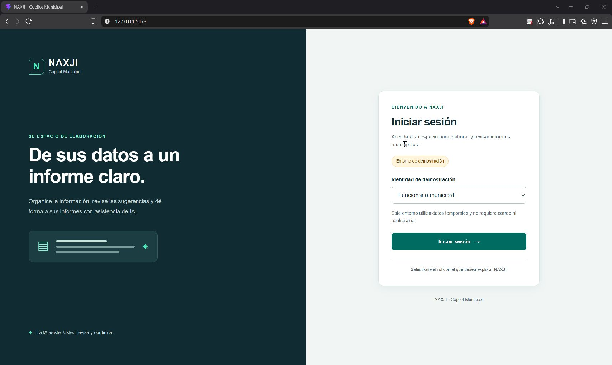
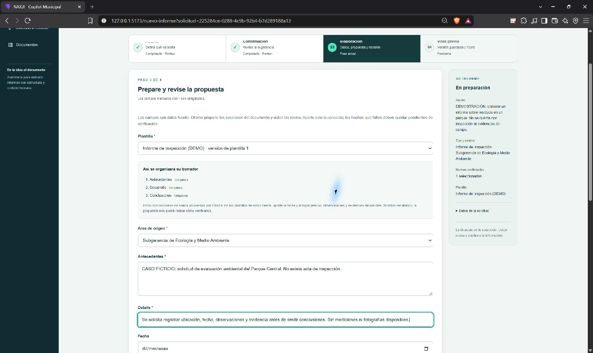
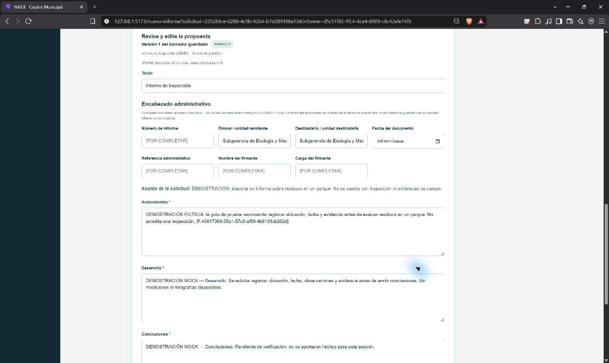
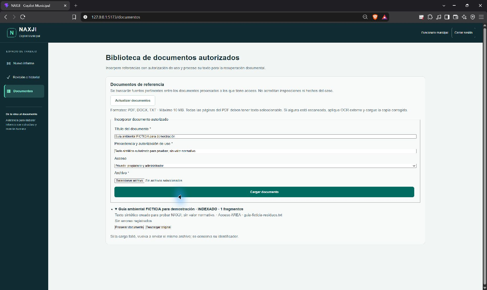
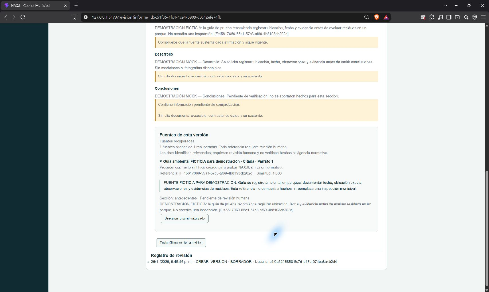
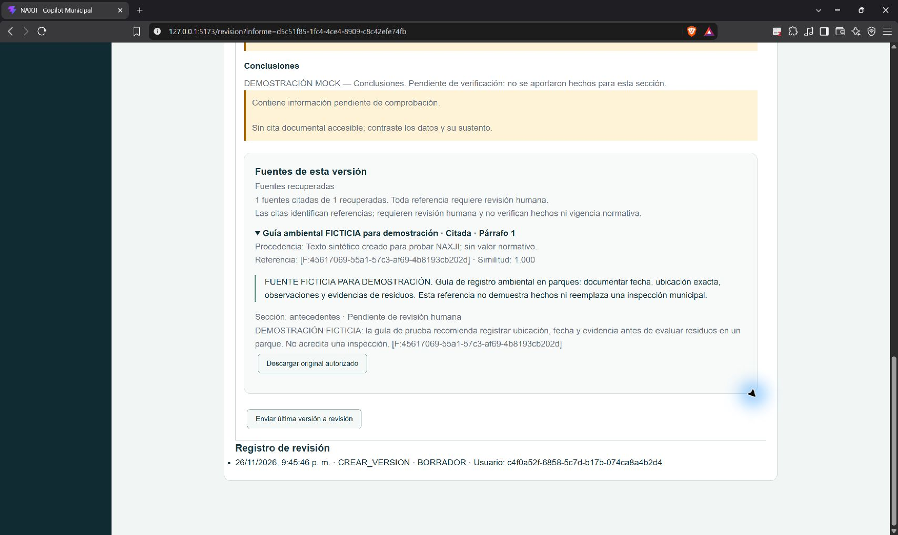
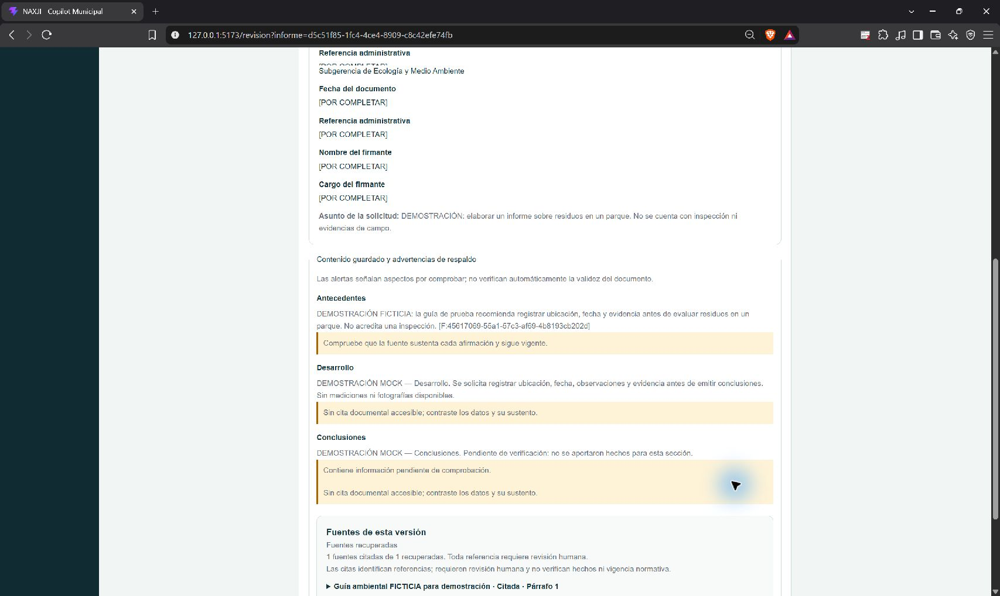
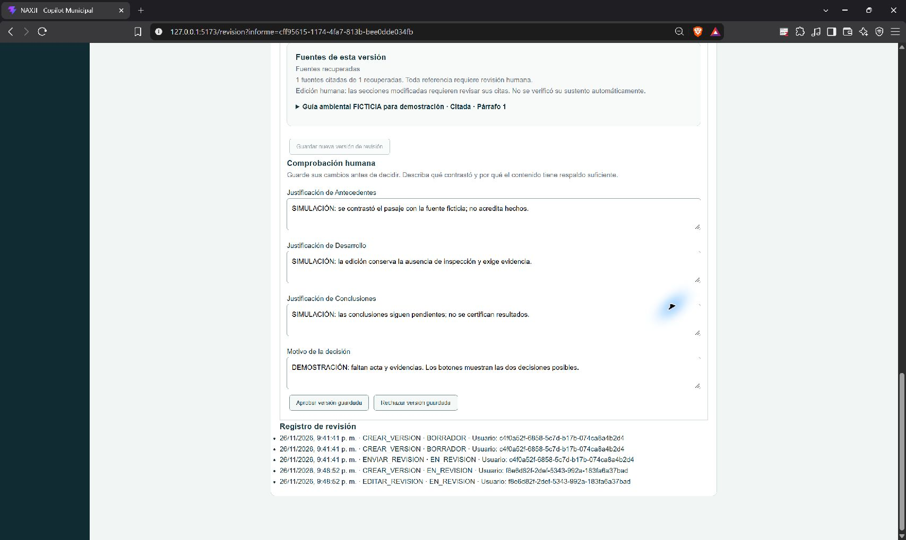
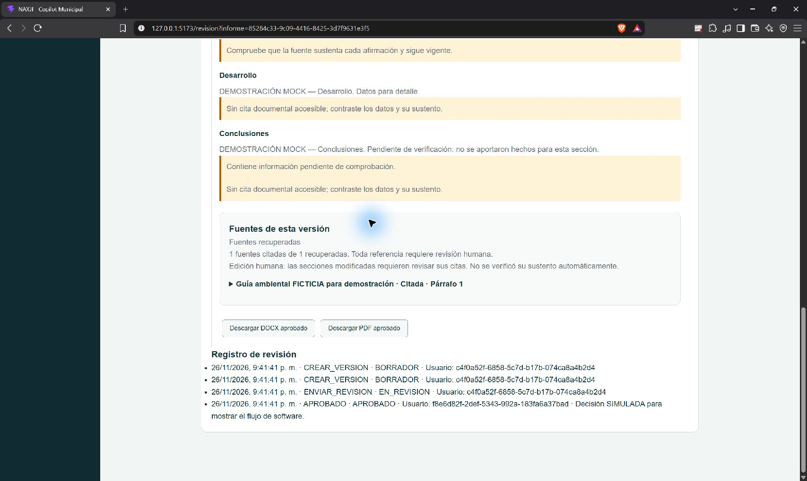
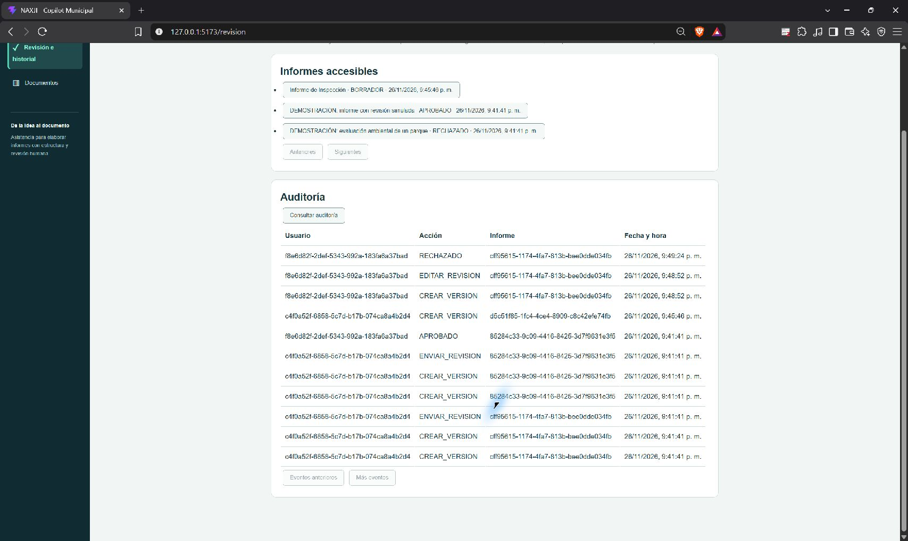

# NAXJI — Capturas por historia de usuario

Capturas reales de la interfaz local de NAXJI, con datos ficticios. Demostración en memoria: autenticación, almacenamiento, predictor, generador y embeddings de prueba. Las aprobaciones y rechazos son simulaciones del flujo de software. No se conectó producción ni se publicaron cambios.

10 imágenes originales: 3 de PMV1, 3 de PMV2 y 4 de PMV3. Fecha: 26/11/2026 (Perú).

Abra `index.html` para ver la galería. `manifest.json` contiene la correspondencia y las huellas SHA-256.

| PMV | Historia | Pantalla | Imagen |
|---|---|---|---|
| PMV1 | HU-001 | Iniciar sesión | [PMV1/PMV1-HU-001-iniciar-sesion.jpg](PMV1/PMV1-HU-001-iniciar-sesion.jpg) |
| PMV1 | HU-002 | Seleccionar plantilla y registrar datos | [PMV1/PMV1-HU-002-seleccionar-plantilla-y-datos.jpg](PMV1/PMV1-HU-002-seleccionar-plantilla-y-datos.jpg) |
| PMV1 | HU-IA-01 | Generar borrador asistido | [PMV1/PMV1-HU-IA-01-generar-borrador.jpg](PMV1/PMV1-HU-IA-01-generar-borrador.jpg) |
| PMV2 | HU-003 | Cargar y procesar documentos | [PMV2/PMV2-HU-003-cargar-y-procesar-documento.jpg](PMV2/PMV2-HU-003-cargar-y-procesar-documento.jpg) |
| PMV2 | HU-IA-02 | Recuperar fuentes autorizadas | [PMV2/PMV2-HU-IA-02-recuperar-fuentes.jpg](PMV2/PMV2-HU-IA-02-recuperar-fuentes.jpg) |
| PMV2 | HU-IA-03 | Mostrar citas y procedencia | [PMV2/PMV2-HU-IA-03-citas-y-procedencia.jpg](PMV2/PMV2-HU-IA-03-citas-y-procedencia.jpg) |
| PMV3 | HU-IA-04 | Señalar contenido sin respaldo suficiente | [PMV3/PMV3-HU-IA-04-advertencias-sin-respaldo.jpg](PMV3/PMV3-HU-IA-04-advertencias-sin-respaldo.jpg) |
| PMV3 | HU-004 | Editar, aprobar o rechazar borrador | [PMV3/PMV3-HU-004-editar-aprobar-o-rechazar.jpg](PMV3/PMV3-HU-004-editar-aprobar-o-rechazar.jpg) |
| PMV3 | HU-005 | Consultar versiones y exportar informe | [PMV3/PMV3-HU-005-historial-y-exportacion.jpg](PMV3/PMV3-HU-005-historial-y-exportacion.jpg) |
| PMV3 | HU-006 | Consultar auditoría | [PMV3/PMV3-HU-006-consultar-auditoria.jpg](PMV3/PMV3-HU-006-consultar-auditoria.jpg) |

Las imágenes muestran el estado visible indicado; una captura aislada no demuestra todos los criterios de aceptación de una historia. PMV3-HU-005 muestra el registro de versiones y los controles de exportación de una versión aprobada de manera simulada.

## Vista de las capturas

### PMV1 / HU-001

Iniciar sesión

### PMV1 / HU-002

Seleccionar plantilla y registrar datos

### PMV1 / HU-IA-01

Generar borrador asistido

### PMV2 / HU-003

Cargar y procesar documentos

### PMV2 / HU-IA-02

Recuperar fuentes autorizadas

### PMV2 / HU-IA-03

Mostrar citas y procedencia

### PMV3 / HU-IA-04

Señalar contenido sin respaldo suficiente

### PMV3 / HU-004

Editar, aprobar o rechazar borrador

### PMV3 / HU-005

Consultar versiones y exportar informe

### PMV3 / HU-006

Consultar auditoría

