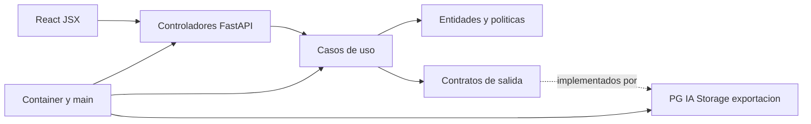

# Prompt 9 — Reconstrucción arquitectónica

Main **4f4d294**, corte 27/11/2026. [Detección](../auditoria/arquitectura_detectada.md), [módulos](modulos.md), [dominio](dominio.md) y [diagrama nativo Understand](../../understand/diagramas/hexagonal-dependencias.svg) describen el mismo producto. No hay migración a Qdrant, TypeScript o Event-Driven.

## Dependencias del código

Dominio no depende de aplicación/infraestructura/adaptadores; aplicación depende de dominio y sus puertos. Adaptadores implementan contratos. [Container](../../../../src/infrastructure/configuration/container.py) y [main](../../../../src/main.py) conocen los proveedores y componen la aplicación. [423 pares de archivos](../../understand/dependencias-rutas.csv), [verificación núcleo](../../understand/verificacion-hexagonal.json) y [guardias AST](../../../../tests/test_arquitectura.py) respaldan el alcance; imports dinámicos y externos no resueltos son límites, no ceros ficticios.

## Flujos de ejecución

1. **PMV 1:** React→controlador→Crear/Actualizar/GuardarSolicitudCompleta→ServiciosSolicitud/dominio→repositorios mediante UoW. PredecirContexto usa el puerto ML; ValidarPrediccion exige decisión humana. GenerarBorrador reserva solicitud, cierra transacción, invoca IA y publica una versión solo si conserva vigencia. [Código](../../../../src/application/use_cases/generar_borrador.py).
2. **PMV 2:** GestionDocumentos valida archivo/permiso, Storage, extracción, fragmentación y embeddings fuera de transacciones prolongadas. [finalizar](../../../../src/adapters/out/persistence/documentos_postgres.py) bloquea intento yreemplaza índice atómicamente. [buscar.sql](../../../../src/adapters/out/persistence/sql/documentos_postgres/buscar.sql) materializa autorizados antes de distancia/orden/límite. La respuesta de informe reevalúa acceso actual a las fuentes.
3. **PMV 3:** RevisionInformes obtiene informe con bloqueo UoW, comprueba usuario/área/versión/estado; edita con nueva versión o decide con evento atómico. [InformeAuditado](../../../../src/adapters/out/persistence/informe_auditado.py) registra nueva versión; [RevisionPostgres](../../../../src/adapters/out/persistence/revision_postgres.py) registra decisiones. Exportar usa el texto a probado persistido, no llama al LLM.

Este esquema **de flujo/composición** no es un grafo de imports; la flecha punteada expresa implementaciones inyectadas. Los gráficos nativos de dependencias se conservan a parte. El [UML del dominio y secuencia transaccional](diagramas_dominio.md) está respaldado por clases y métodos reales.

HTTP es síncrono a nivel del caso de uso; las reservas ylos registros SQL no implican broker, workers, event sourcing oCQRS con almacenes separados. Los adaptadores pueden consumirconfiguración exterior: el ciclo infraestructura/salida no se oculta ni se declara una arquitectura másestrictaquelademostrada.

## Antecedente literal conservado de 4f4d294

Texto heredado, anterior a esta revisión documental del 27/11/2026. Las referencias a Understand bloqueado, ausencia de ZAP o falta de validación Linux describen aquel diagnóstico; quedan superadas por las evidencias vigentes enlazadas arriba. Los logs y mediciones originales no se alteran.

> Actualización de cierre: los 3 PMV/10 HU están aceptados académicamente por instrucción del usuario. Este archivo conserva el corte técnico anterior. La evidencia vigente de guardias completas, ZAP real, CI y entrega Linux/Docker está en `docs/RESULTADOS_CIERRE.md`, `docs/MATRIZ_OBSERVACIONES_CIERRE.md` y `docs/INDICE_12_ENTREGABLES.md`. Understand continúa bloqueado; las omitidas no son aprobadas.

# Flujo arquitectónico real

React → API → caso de uso → dominio/puertos → adaptadores → PG/Ollama/Storage/exportación. Container hace la composición. Pruebas AST verifican que dominio/aplicación no importen infraestructura/frameworks.

Las reservas desacoplan inferencia de bloqueos largos, pero HTTP sigue siendo síncrono. Finalizar un índice usa bloqueo por intento y una transacción; buscar filtra el corpus autorizado antes de ordenar/limitar. PMV3 bloquea la versión vigente y confirma decisión/evento juntos. Se comprobó concurrencia entre instancias y rollback cuando falla el evento. No se encontraron broker, workers, Qdrant o TypeScript; esos elementos del informe requieren corrección documental.
