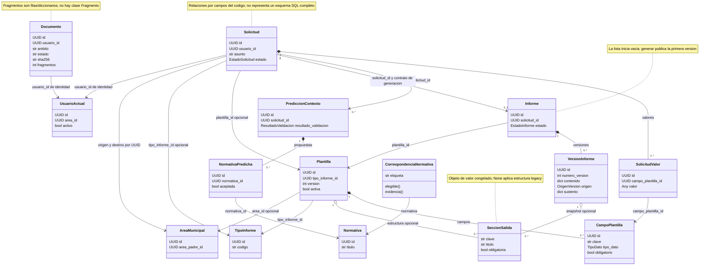
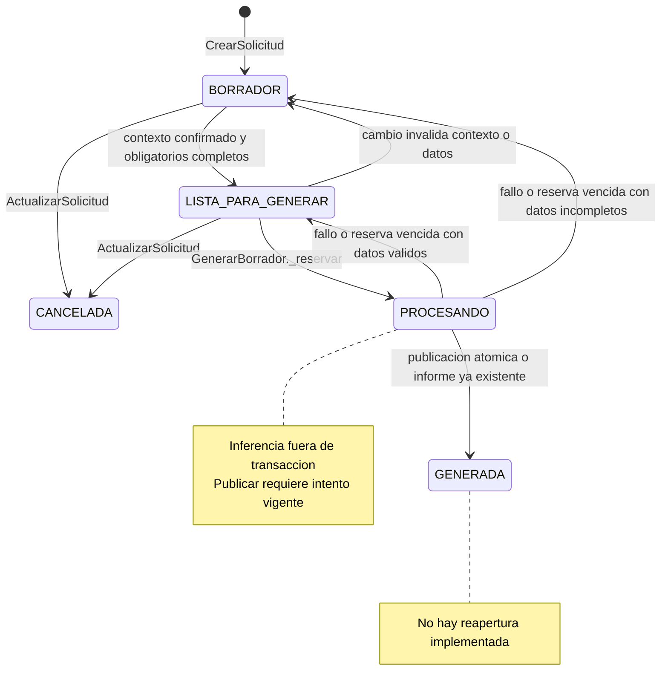
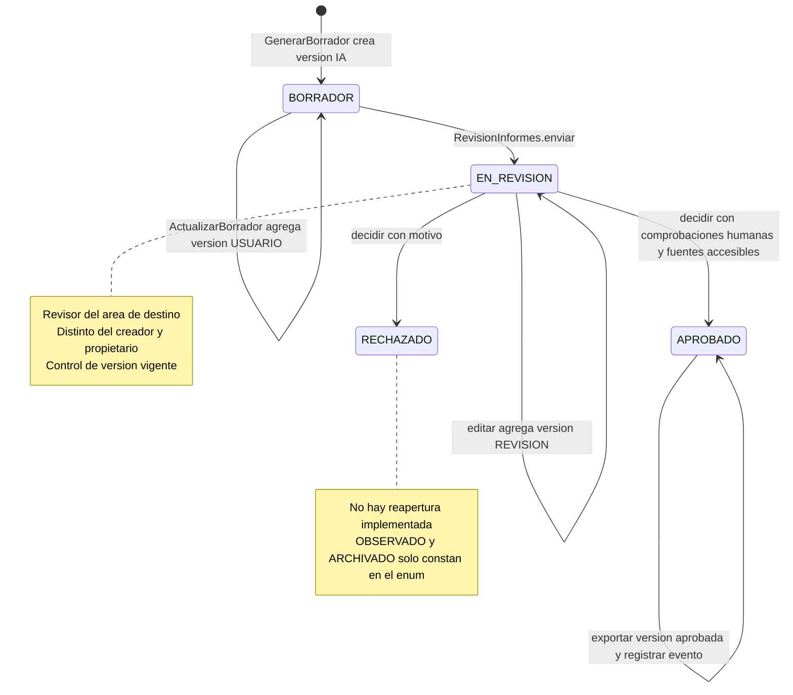
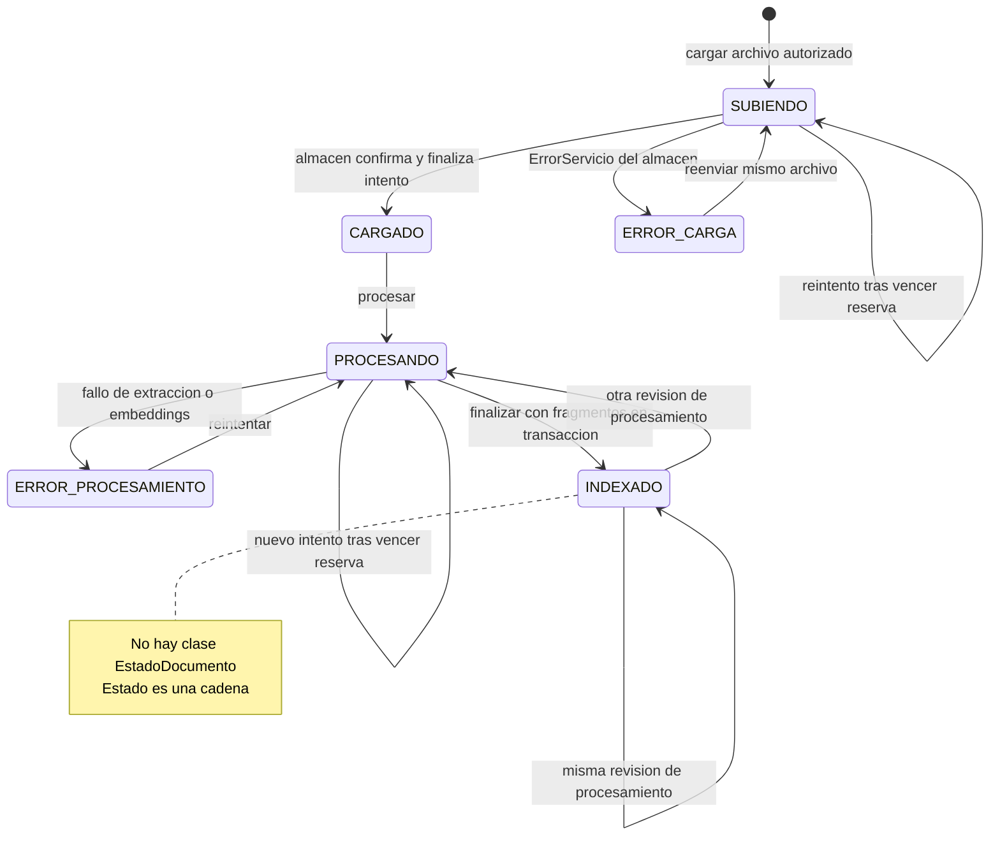

# UML textual — dominio de NAXJI

Reconstrucción manual desde código de `main` **4f4d294**, corte **27/11/2026**. Los diagramas son documentación Mermaid, no resultados generados por Understand ni nuevos diseños para implementar. [Dominio completo y reglas](dominio.md), [inventario de símbolos](../cierre-documental-20261127/inventario-fuente.json).

Las clases y operaciones mostradas existen en el repositorio. Se seleccionan campos para legibilidad; la nulabilidad y los tipos completos están en el inventario y código. Las cardinalidades reflejan listas/referencias/contratos de aplicación, no una verificación de todas las FK en una base desplegada. Las composiciones describen agregados observados, sin una clase `AggregateRoot` propia.

| Diagrama | Código que respalda su lectura |
| ---| ---|
| Clases | [Entidades](../../../../src/domain/entities/), [SeccionSalida](../../../../src/domain/value_objects/seccion_salida.py), [contratos de repositorios](../../../../src/application/ports/output/) |
| Solicitud | [ServiciosSolicitud](../../../../src/application/use_cases/servicios_solicitud.py), [ActualizarSolicitud](../../../../src/application/use_cases/actualizar_solicitud.py), [GenerarBorrador](../../../../src/application/use_cases/generar_borrador.py) |
| Informe | [ActualizarBorrador](../../../../src/application/use_cases/actualizar_borrador.py), [RevisionInformes](../../../../src/application/use_cases/revision_informes.py) |
| Documento | [GestionDocumentos](../../../../src/application/use_cases/documentos.py), [DocumentosPostgres](../../../../src/adapters/out/persistence/documentos_postgres.py) |
| Secuencia de decisión | [RevisionInformes.decidir](../../../../src/application/use_cases/revision_informes.py), [InformeAuditado](../../../../src/adapters/out/persistence/informe_auditado.py), [PostgresUnidadTrabajo/InformeRepositoryPostgres](../../../../src/adapters/out/persistence/postgres.py), [RevisionPostgres](../../../../src/adapters/out/persistence/revision_postgres.py) |

## Clases y relaciones

[Fuente Mermaid](diagramas/clases-dominio.mmd).



## Estados de solicitud

[Fuente Mermaid](diagramas/estados-solicitud.mmd).



## Estados de informe

[Fuente Mermaid](diagramas/estados-informe.mmd).



## Estados de documento

[Fuente Mermaid](diagramas/estados-documento.mmd).



## Secuencia de decision PMV 3

[Fuente Mermaid](diagramas/secuencia-revision.mmd).

```mermaid
sequenceDiagram
  actor Persona as Revisor del area de destino
  participant API as revision_controller
  participant Caso as RevisionInformes
  participant UoW as PostgresUnidadTrabajo
  participant Informes as InformeAuditado
  participant Repo as InformeRepositoryPostgres
  participant Eventos as RevisionPostgres
  Persona->>API: decidir numero_version, decision, motivo, comprobaciones
  API->>Caso: decidir(...)
  Caso->>UoW: transaccion()
  Caso->>Informes: obtener_por_id(informe_id)
  Informes->>Repo: obtener_por_id(informe_id)
  Repo-->>Caso: informe con bloqueo de fila en UoW activa
  Note over Caso: autor distinto, area de destino, version vigente y EN_REVISION
  Note over Caso: APROBADO exige comprobaciones y fuentes accesibles
  Caso->>Informes: guardar(informe con decision)
  Informes->>Repo: guardar(informe)
  Note over Informes: no hay nueva version en una decision; no duplica CREAR_VERSION
  Caso->>Eventos: registrar(evento de decision)
  alt todas las operaciones validas
    UoW-->>Caso: commit conjunto
    Caso-->>API: historial autorizado y fuentes protegidas
    API-->>Persona: resultado
  else conflicto o fallo dentro de transaccion
    UoW-->>Caso: rollback conjunto
    Caso-->>API: error de dominio o persistencia sanitizado
  end
```
