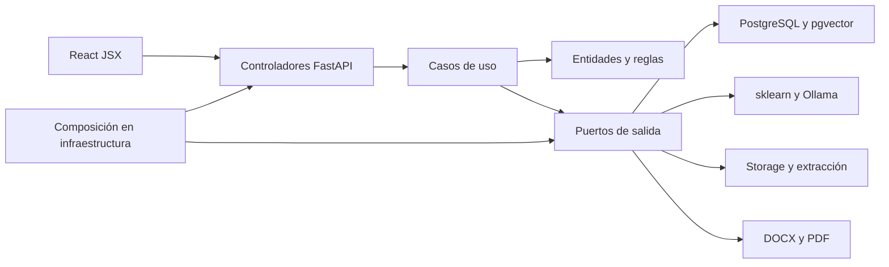

# Actualización as-built del cierre

Base `main` **7359a67**. Los **3 PMV y 10 HU están aceptados para el cierre académico por instrucción del usuario**. La validación institucional externa queda fuera del alcance. Las pruebas omitidas conservan ese estado. No se modifican pilotos, predictor, RAG, HU-IA-04, esquema ni documentos académicos originales.

Inventario actual:110 módulos Python,599 referencias import;16 módulos de persistencia y46 recursos SQL. Todos se recorren, resolviendo imports relativos, y se importan en pytest. Sin infracciones confirmadas. Solo cambia la entrega HTTP (nosniff) y configuración de despliegue;entidades,casos de uso,pilotos,predictor,RAG y HU-IA-04 no cambian. ZAP2.17.0 se ejecutó en red local Docker internal con informes antes/después;Understand no se ejecutó. Windows y Linux Docker/CI tienen evidencia real, con cortes explícitos. [Índice de12 entregables](INDICE_12_ENTREGABLES.md) y [despliegue](PREPARACION_DESPLIEGUE.md).

---

## Antecedente conservado (corte anterior)

# Ingeniería inversa de NAXJI

## 1. Resumen ejecutivo

Aplicación web con backend Python/FastAPI, React JSX, PostgreSQL/pgvector, sklearn y Ollama. Arquitectura de puertos/adaptadores con cuatro carpetas principales. La implementación no contiene Qdrant, TypeScript, broker ni workers de eventos. PMV3 añade revisión de una etapa, historial, auditoría y exportación aprobada Word/PDF mediante una bandera explícita.

## 2. Objetivos

Reconstruir el sistema ejecutable, identificar contratos/dependencias/dominio y relacionar hallazgos con correcciones y pruebas. Separar diseño propuesto, ejecución local, simulaciones y validación institucional.

## 3. Alcance

Código desde d99f960 más commits locales de esta rama; referencias de Unidad III y evaluación histórica del 20/11. Sin publicación de originales académicos, despliegue ni escrituras en Supabase compartido. El inventario deriva del código y OpenAPI local, no de un escaneo productivo.

## 4. Metodología

### 4.1 Auditoría

Se leyeron referencias y Trello, se inspeccionaron archivos/AST/SQL y se ejecutó la línea base. `alcance_y_fuentes.md` fija autoridad y contradicciones.

### 4.2 Instalación

Instalación npm aislada desde lock corregido y backend wheel en venv nuevo. Recursos SQL, modelos y DOCX incluidos; importación fuera del repositorio comprobada. Entorno verificado Windows/Python 3.11; instrucciones Ubuntu preparadas, sin atribuirles una ejecución inexistente.

### 4.3 Configuración

`Settings` y `DatabaseSettings` componen el backend; variables privadas no se exportan al navegador. Se preservaron los `.env` existentes. RAG y PMV3 opt-in, sin migraciones automáticas al iniciar.

### 4.4 Ejecución

pytest, frontend en Node/JSDOM, lint, build, PG/pgvector desechable, sklearn y Ollama reales donde se indica. La carga mide HTTP real, con identidad/Storage/LLM/embeddings dobles explícitos. Ningún resultado de dobles se presenta como Supabase/Ollama real.

### 4.5 Ingeniería inversa

Se aplicaron los doce prompts: inventario tecnológico, arquitectura detectada, dependencias, entorno, variables, logs, funcionalidades, dominio, reconstrucción arquitectónica, evaluación, hallazgos y consolidación final. Sus salidas específicas están en `evidencias/ingenieria-inversa/`.

## 5. Inventario tecnológico

| Componente | Implementación comprobada | Evidencia |
|---|---|---|
| Web | React/React Router, JSX/JavaScript, Vite, Axios | `package.json`, lock, `adapters/in/web` y build |
| API | FastAPI, Pydantic, Uvicorn; contratos REST | `main.py`, controllers/schemas y OpenAPI local |
| Persistencia | psycopg/PostgreSQL y pgvector(1024) | adaptadores, SQL recursos y pruebas PG |
| Predicción | LogisticRegression tipo/área y OneVsRestClassifier[LogisticRegression] normativo | artefactos inspeccionados y huellas verificadas |
| Generación | Ollama `qwen2.5:7b`, JSON con esquema, reglas y validadores | adaptador y tests reales |
| Embeddings | Ollama `bge-m3:567m`, 1024 dimensiones | recuperación real con pgvector |
| Identidad/archivos | Supabase Auth REST y Storage privado | adaptadores y contratos; institucional pendiente |
| Exportación | python-docx y ReportLab; PDF del texto del Word guardado | pruebas de contenido y render PDF |

Versiones exactas runtime en `requirements-runtime.lock.txt`, árbol frontend en lock/SBOM. `evidencias/cierre-trazable/ingenieria-inversa/inventario.json` contiene clases, rutas y conteos medidos, con la limitación explícita del escaneo de variables compuestas.

## 6. Arquitectura detectada

Confianza alta: dominio/aplicación no importan frameworks ni infraestructura según AST. La composición importa adaptadores. Algunas configuraciones de proveedores pertenecen a infraestructura y son consumidas por adaptadores: no se afirma pureza absoluta de toda dependencia. HTTP, recuperación y generación son flujos síncronos; las reservas/transacciones evitan doble publicación, sin broker.

## 7. Dependencias

Críticas: FastAPI/Pydantic para contratos, psycopg para transacciones, sklearn/joblib y sus dependencias numéricas, httpx para proveedores, pypdf/multipart para documentos y python-docx/ReportLab para exportar. QA utiliza pytest, Node/JSDOM y ESLint. Locks, auditorías y SBOM se conservan separados del software ejecutado. Ausencia de avisos conocidos en la consulta no prueba seguridad total.

## 8. Configuración

Guía completa y tabla sin secretos en `GUIA_CIERRE_Y_DEMO.md`. Nombres y valores de ejemplo están en `.env.example`; ningún valor real se publica. Las URLs de proveedores se configuran en servidor; un nombre de procedencia no provoca descargas arbitrarias.

## 9. Ejecución

`verificar_cierre.py` registra comandos/fechas/códigos/huellas en un directorio nuevo. Los fixtures fijan loopback/rol de pruebas, crean bases aleatorias y las eliminan. Logs y resultados actuales en `RESULTADOS_CIERRE.md`. `/health` comprueba proceso; `/ready` es una comprobación de lectura reservada a administración.

## 10. Reconstrucción arquitectónica

`Container` selecciona memoria o PostgreSQL sin fallback silencioso. Las dependencias se inyectan por puertos. La generación reserva la solicitud, realiza inferencia sin retener bloqueos y publica una versión únicamente si conserva la reserva. Los documentos tienen reservas por intento; los fragmentos se escriben atómicamente. SQL filtra permisos antes de distancia/orden/límite. PMV3 bloquea el informe, comprueba versión vigente, guarda estado y evento en la misma transacción; dos instancias no pueden decidir dos veces.

## 11. Dominio reconstruido

| Agregado / objeto | Relaciones y reglas |
|---|---|
| Solicitud / SolicitudValor | Propietario, asunto, tipo/áreas/plantilla y datos; no generar sin contexto confirmado y obligatorios |
| Informe / VersionInforme | Una solicitud, múltiples snapshots; número creciente, contenido/título/estructura/fuentes conservados |
| PrediccionContexto / NormativaPredicha | Sugerencia pendiente; aceptación/corrección/rechazo humano; etiquetas no validan norma jurídica |
| Plantilla / CampoPlantilla / SeccionSalida | Campos fuente distintos de estructura de salida; versiones y compatibilidad con tipo/área |
| Documento / fragmentos | Propietario/ámbito/área/hash; contenido extraído, índice por procesamiento; acceso actual a originales y fuentes |
| UsuarioActual / roles | Perfil activo e identidad verificada en servidor; no se confía en roles del navegador |
| Eventos de revisión | Registro append-only con usuario/acción/informe/versión/estado/fecha/detalle; administración consulta |

Transiciones implementadas PMV3: BORRADOR → EN_REVISION → APROBADO o RECHAZADO. Editar en revisión crea una versión nueva; no cambia las anteriores. No hay segunda aprobación. Las constantes OBSERVADO/ARCHIVADO existen previamente, pero no se inventan flujos nuevos para ellas. Versiones anteriores sin historia de estado muestran `NO_REGISTRADO`.

## 12. APIs e integraciones

Inventario OpenAPI local: 42 operaciones documentadas al corte, incluidas `/health`, Auth, catálogos, solicitudes/contexto/generación, informes, documentos, revisión, auditoría y `/ready`. Las rutas privadas comprueban identidad y rol/propiedad/área en el servidor. `revision_controller.py` pagina listas y limita decisiones a una versión. La exportación final carga datos persistidos, no recibe texto del navegador ni llama a la IA.

## 13. Hallazgos

`hallazgos_y_correcciones.md` relaciona H-02…H-14 y defectos nuevos con archivo/prueba/evidencia. La consistencia de código no se usa para declarar aceptados formatos, datos o una institución.

## 14. Riesgos

Acceso y revocación reales, RLS/Storage, cookies del navegador, corpus representativo, licencias y disponibilidad del servicio IA siguen abiertos. Las reglas de texto detectan condiciones estructurales, no toda alucinación. La trazabilidad de una cita no equivale a vigencia ni implicación semántica. Los joblib solo se cargan desde artefactos versionados con huellas; custodia/pipeline requieren revisión externa.

## 15. Recomendaciones

Validar perfiles por rol/área y bucket en staging aislado autorizado; aprobar formatos institucionales; obtener corpus/ground truth y revisión humana; completar papel científico en inglés con resultados fechados; acordar SLO/cuotas después de medir servicios reales. Ejecutar Understand solo con herramienta/licencia disponibles. No migrar a Qdrant/TypeScript/eventos para hacer coincidir descripciones antiguas.

## 16. Conclusiones

El sistema reconstruido corresponde al stack ejecutable y a diez HU originales. Se corrigieron defectos y se registraron pruebas reales diferenciadas por entorno. La validación local y las simulaciones aportan evidencia técnica; no demuestran por sí solas generalización ML, ahorro municipal, sostenibilidad medida o aceptación institucional.
