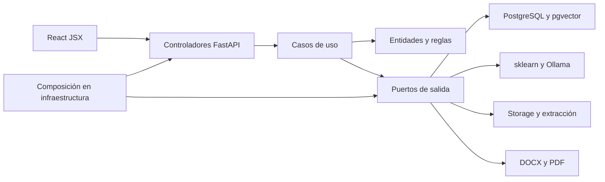

# Prompt 12 — Informe consolidado de ingeniería inversa de NAXJI

**Cierre documental del 27/11/2026**, sobre main **4f4d294f615cf0285d19f23d0f2aabbf1ee339d1**. Los tres PMV y las diez HU están completos dentro del alcance académico acordado. La validación institucional externa queda fuera. El informe académico fue actualizado por separado según el usuario; no se modifica ni se recalifica aquí.

[Matriz de cumplimiento de los doce prompts](INDICE_12_ENTREGABLES.md), [reconstrucción completa del dominio](evidencias/ingenieria-inversa/analisis/dominio.md), [UML textual](evidencias/ingenieria-inversa/analisis/diagramas_dominio.md), [verificación documental](evidencias/ingenieria-inversa/cierre-documental-20261127/README.md).

## 1. Método, fuentes y alcance

Lectura directa de código, manifiestos, SQL, contratos y logs existentes. El [inventario AST](evidencias/ingenieria-inversa/cierre-documental-20261127/inventario-fuente.json) registra archivos, clases, campos, métodos y líneas; los [149 hashes](evidencias/ingenieria-inversa/cierre-documental-20261127/fuentes-sha256.json) coinciden con las fuentes del análisis Understand. Se revisan 110 módulos Python de `src`, dos de `deploy` y 37 archivos Web. No se deserializan ni reentrenan modelos para esta documentación.

Se distinguen observación del código, inferencia arquitectónica, medición de herramienta y aceptación académica informada por el usuario. La documentación no prueba por sí misma aceptación institucional, generalización ML, vigencia jurídica, ahorro ni sostenibilidad medida. Los 12 prompts son entregables de análisis, no 12 requisitos nuevos.

## 2. Inventario tecnológico — Prompt 1

| Componente final | Fuente y evidencia |
| ---| ---|
| Python/FastAPI/Pydantic/Uvicorn | [pyproject](../pyproject.toml), [main](../src/main.py), [CI](../.github/workflows/ci.yml) |
| React/JavaScript/JSX/Vite/Router/Axios | [package](../package.json), [Web](../src/adapters/in/web/), [vite.config](../vite.config.js) |
| PostgreSQL/pgvector y psycopg | [persistencia](../src/adapters/out/persistence/), [SQL de búsqueda](../src/adapters/out/persistence/sql/documentos_postgres/buscar.sql), [migraciones](../database/migrations/) |
| Supabase Auth/Storage | [Auth](../src/infrastructure/auth/supabase.py), [almacén](../src/adapters/out/documents/almacen_supabase.py) |
| scikit-learn/LogisticRegression | [predictor](../src/adapters/out/ai/sklearn_context_predictor.py), [configuración](../src/infrastructure/ai/models/model_config.json), [replay/procedencia](evidencias/cierre-trazable/ml/procedencia-particiones-replay.json) |
| O llama qwen2.5:7b | [Settings](../src/infrastructure/configuration/settings.py), [adaptador](../src/adapters/out/ai/ollama_adapter.py) |
| Embeddings bge-m3:567m/1024 | [RagSettings](../src/infrastructure/configuration/rag.py), [evidencia real](evidencias/cierre-trazable/rag-embeddings-reales.json) |
| Extracción/exportación | [documents](../src/adapters/out/documents/): pypdf, python-docx, ReportLab; sin OCR universal integrado |

Qdrant, TypeScript y Event-Driven fueron **alternativas evaluadas**, no forman parte de la implementación final. El clasificador normativo es OneVsRestClassifier[LogisticRegression]; RF-IA-01 es un identificador histórico, no el nombre del algoritmo. Los paquetes `@types/*` no convierten JSX en TypeScript. [Descubrimiento completo](evidencias/ingenieria-inversa/auditoria/stack_tecnologico.md).

## 3. Arquitectura detectada — Prompt 2

Arquitectura hexagonal: dominio con entidades/valores/políticas; aplicación con casos y puertos; adaptadores HTTP/Web y de salida; infraestructura y bootstrap para configuración/composición. [Container](../src/infrastructure/configuration/container.py) inyecta implementaciones de los puertos; [main](../src/main.py) registra controladores y handlers.

[Guardias AST](evidencias/cierre-seguridad-20261126/arquitectura-release/resultado.json):110 módulos, 599 referencias import, 0 infracciones. [Understand](evidencias/understand/verificacion-hexagonal.json):423 pares propios resueltos, 0 infracciones de dominio/aplicación evaluadas. Son mediciones distintas. Los imports dinámicos y dependencias externas no resueltas limitan la comprobación; no se declara aislamiento absoluto de todas las capas exteriores. [Detección detallada](evidencias/ingenieria-inversa/auditoria/arquitectura_detectada.md).

## 4. Dependencias — Prompt 3

Declaración canónica [pyproject.toml](../pyproject.toml), resolución [runtime lock](../requirements-runtime.lock.txt), QA [requirements-test](../requirements-test.txt); [package-lock](../package-lock.json) fija frontend. Dependencias críticas: framework HTTP, psycopg, sklearn/joblib/transitivas numéricas, httpx, extracción y exportación. Dependencias de desarrollo separadas del bundle/runtime.

[Backend](evidencias/ingenieria-inversa/dependencias/backend.md), [frontend](evidencias/ingenieria-inversa/dependencias/frontend.md), [infraestructura](evidencias/ingenieria-inversa/dependencias/infraestructura.md), [SBOM/auditorías históricas](evidencias/cierre-trazable/dependencias/) y [CSV de dependencias Understand](evidencias/understand/dependencias-rutas.csv). Una auditoría sin avisos conocidos en su corte no prueba ausencia actual de vulnerabilidades. No se actualizan librerías en este cierre.

## 5. Entorno e instalación — Prompt 4

Python>=3.11, Node/npm y Docker para el entorno aislado; O llama solo donde se ejecutan integraciones reales autorizadas. Hay evidencia de Windows y Linux: [empaquetado](evidencias/cierre-trazable/empaquetado/), [Docker runtime 3.11-slim](../Dockerfile), [CI Ubuntu/Python 3.11/Node 24](../.github/workflows/ci.yml). No son solo comandos sugeridos para Linux.

El [arranque](../deploy/start.py) validaPORT y lanza Uvicorn con usuario de contenedor 10001; healthcheck comprueba liveness. [Preflight](../deploy/preflight.py) valida configuración offline yno contacta servicios. Migraciones/semillas son manuales en entorno autorizado, no se aplican al iniciar. RAG/PMV 3 tienen banderas y prerrequisitos; false por defecto no implica HU sin implementar. [Instalación](evidencias/ingenieria-inversa/configuracion/instalacion.md), [servicios](evidencias/ingenieria-inversa/configuracion/servicios.md), [guía de despliegue](PREPARACION_DESPLIEGUE.md).

## 6. Variables/configuración — Prompt 5

`environment()` combina `.env` < `.env.local` < variables de proceso, sin interpolar secretos ni sobrescribir archivos. Configuración servidor: DatabaseSettings/Settings/RagSettings/SupabaseAuthSettings; frontera pública Web:`VITE_API_URL` al compilar. Las claves privadas Storage, contraseñaPG y credenciales no se publican al frontend.

[Tabla de nombres, defaults y condiciones](evidencias/ingenieria-inversa/configuracion/variables_entorno.md), [fuente DatabaseSettings](../src/infrastructure/configuration/database.py), [RagSettings](../src/infrastructure/configuration/rag.py), [Auth](../src/infrastructure/auth/supabase.py). No se leyeron valores privados ni se probó un proyecto compartido. La configuración preparada no certifica credenciales, políticas, cookies o disponibilidad del destino.

## 7. Ejecución y análisis de logs — Prompt 6

[Backend](evidencias/ingenieria-inversa/ejecucion/backend_logs.md), [frontend](evidencias/ingenieria-inversa/ejecucion/frontend_logs.md) y [rutas](evidencias/ingenieria-inversa/ejecucion/endpoints_detectados.md) separan cortes y entornos. La [lectura AST de rutas](evidencias/ingenieria-inversa/cierre-documental-20261127/rutas-estaticas.json) identifica 42 operaciones visibles yelalias de solicitud fuera del esquema; no se consulta OpenAPI productivo.

Se preservan fallos previos de pruebas, checkout superficial y timeout de PyPI con sus correcciones/repeticiones. Las 21 omitidas permanecen omitidas y la deprecación Starlette/TestClient/httpx es una advertencia de QA, no un fallo nuevo. Los logs deUnderstand 0/224 corresponden a análisis estático, no a errores de ejecución de FastAPI. No se deduce ausencia global de errores de un escaneo local.

## 8. Funcionalidades — Prompt 7

PMV 1: HU-001 acceso/perfil, HU-002 solicitud/formulario, HU-IA-01 sugerencia/contexto confirmado y borrador. PMV 2: HU-003 carga/procesamiento, HU-IA-02 recuperación autorizada, HU-IA-03 fuentes/citas. PMV 3: HU-IA-04 advertencias de respaldo, HU-004 edición/decisión, HU-005 historial/exportación a probada, HU-006 auditoría.

[Diez HU mapeadas a código y pruebas](evidencias/ingenieria-inversa/analisis/casos_uso.md), [matriz HU](matriz_trazabilidad.md), [capturas existentes](evidencias/capturas-hu-20261126/README.md). No se agrega móvil, OCR universal, segunda aprobación ni historias derivadas de los prompts. La exportaciónlegacy conserva su contrato, separado de la exportación a probada dePMV 3.

## 9. Dominio reconstruido — Prompt 8

La [reconstrucción detallada](evidencias/ingenieria-inversa/analisis/dominio.md) identifica todas las clases de las ocho fuentes de entidades, valores/enums, servicios/políticas, repositorios, reglas y transiciones. [UML de clases, estados y secuencia](evidencias/ingenieria-inversa/analisis/diagramas_dominio.md); [fuentes.mmd](evidencias/ingenieria-inversa/analisis/diagramas/).

| Estructura real | Relaciones y límites |
| ---| ---|
| Solicitud/SolicitudValor | Propietario, catálogos, plantilla y valores; guardado agregado y datos tipados/obligatorios. |
| Informe/VersionInforme | Una solicitud, números de versión, contenido y snapshots de título/estructura/sustento; no se reescriben versiones guardadas. |
| PrediccionContexto/NormativaPredicha | Sugerencia ML de la solicitud, confianzas y validación humana; solo la última predicción yel asunto vigente habilitan generar. |
| Plantilla/CampoPlantilla/SeccionSalida | Entrada y estructura de salida separadas; puerto de plantilla de lectura, no autoría institucional nueva. |
| Documento | Propietario/ámbito/área/hash, estado/intento y revisión de índice; fragmentos son filas/diccionarios, no clase Fragmento inventada. |
| Catálogos/CorrespondenciaNormativa | Identidades de tipo, área, norma yrelacióncurada; reglas técnicas de elegibilidad, no certificación legal. |
| UsuarioActual | Snapshot congelado con UUID, roles, área y activo; identidad real, no VO sin identidad. |

SeccionSalida es un VO congelado; enums no son entidades. DTO congelados de aplicación —DatosSolicitud, ContextoConfirmado, NormaConfirmada, ResultadoBorrador— no se reclasifican como dominio. Los agregados se infieren de composición/contratos, no existe AggregateRoot propio. Encabezados, citas y eventos se representan como diccionarios. No hay event sourcing, event bus, broker ni motor genérico de workflow.

Las invariantes están distribuidas en servicios de dominio, casos, puertos/implementaciones y SQL; las dataclasses no encapsulan todas las transiciones. El revisor debe ser **del área de destino y distinto del creador del informe ydel propietario de la solicitud**. ADMINISTRADOR no sustituye ese contrato; APROBADOR heredado no crea segunda etapa. OBSERVADO/ARCHIVADO son enums heredados sin flujos públicos nuevos. [Código de revisión](../src/application/use_cases/revision_informes.py).

## 10. Reconstrucción arquitectónica — Prompt 9

[Flujos y composición](evidencias/ingenieria-inversa/analisis/arquitectura_real.md), [módulos](evidencias/ingenieria-inversa/analisis/modulos.md) y [dependencias nativas](evidencias/understand/diagramas/hexagonal-dependencias.svg). La generación reserva/publica en transacciones cortas y realiza inferencia fuera de conexiones PG. Documentos se finalizan por intento vigente, fragmentos/estado atómicos; SQL autoriza antes de distancia/orden/límite. Revisión bloquea informe/versión, guarda decisión/evento en la misma UoW y exporta bytes del contenido a probado persistido.

Estos mecanismos no convierten HTTP en una arquitectura Event-Driven. La flecha deun esquema de ejecución no se usa como prueba de dirección de imports; las dependencias del núcleo tienen comprobaciones separadas.

## 11. Evaluación arquitectónica y resultados — Prompt 10

| Evidencia/corte | Resultado conservado | Límite |
| ---| ---| ---|
| [CI main 4f4d294](https://github.com/N-stack22/NAXJI---Copilot-Municipal/actions/runs/46023410611) | 375 backend a probadas, 21 omitidas, 1 advertencia; 55 frontend a probadas, 0 fallidas/omitidas; lint, build, wheel/sdist, Docker ydiff correctos | 10 optativas Supabase/Auth y 11 Ollama/embeddings omitidas; no sumar repeticiones. |
| [Carga 750 final](evidencias/cierre-seguridad-20261126/carga-750-final/resultado.json) | 750 llamadas con resultado esperado, 0 errores inesperados, 125 rechazos previstos | Auth/Storage/LLM/embeddings/decisión humana con dobles; HTTP, sklearn, PG/pgvector, DOCX/PDF reales. |
| [ZAP antes/después](evidencias/cierre-seguridad-20261126/zap/) | Ejecutado y cabeceras corregidas; sin altas/medias/bajas posteriores en objetivos descritos | Informativos y límites del crawler autenticado conservados; no producción. |
| [Understand 8.1.1269](evidencias/understand/README.md) | 149 archivos, 6.719 líneas de código, 141 clases, 696 funciones, máximo ciclomático 26; SonargraphMaintainability 84,44774960712785; 423 relaciones y 0 infracciones evaluadas del núcleo | 0 errores/224 advertencias; Halstead global no disponible; limitaciones de exportación documentadas; no porcentaje de calidad institucional. |
| [FURPS+](03_auditoria_implementacion_furps.md), [OWASP 2021](06_auditoria_implementacion_owasp.md), [ICACIT](ICACIT_EVIDENCIAS.md) | Siete competencias evaluadas mediante evidencia técnica y alcance; diezHU aceptadas académicamente | No nueva nota, rúbrica, encuesta, acta, CO 2 o ahorro inventado. |

[Evaluación detallada](evidencias/ingenieria-inversa/analisis/calidad_arquitectura.md), [resultados generales](RESULTADOS_CIERRE.md). Los juicios numéricos del antecedente son históricos, no una calificación actual. Este cierre no repite Understand, ZAP, carga ni suiteslocales; se verificaCI al publicar como se solicita.

## 12. Hallazgos y recomendaciones — Prompt 11

Correcciones documentales: Prompt 8 ampliado; orden exacto de 12 prompts; Understand/ZAP/Linux actualizados; roles y estados precisados; VO/DTO/agregados distinguidos; alternativas separadas del stack final; enlaces y consolidado coherentes. [Registro de correcciones](evidencias/ingenieria-inversa/analisis/hallazgos.md), [matriz de observaciones](MATRIZ_OBSERVACIONES_CIERRE.md).

No queda una observación documental abierta de ingeniería inversa en el alcance acordado. Los requisitos operativos de destino y validación institucional externa permanecen fuera: credenciales/políticas/revocación, cookies/TLS, servicio IA estable, corpus representativo/revisiónhumana y ratificación de formato. No se declaran verificados ni se exige cambiar el producto para cerrarlos académicamente.

Recomendación: usar las guías versionadas en un entorno autorizado cuando el operador habilite servicios; conservar la trazabilidad por commit y las limitaciones al reutilizar evidencias. No reentrenar, migrararquitectura oquitar advertencias para aparentar cumplimiento. El informe académico actualizado por separado no se edita aquí.

## 13. Conclusiones y entrega — Prompt 12

Los doce prompts quedan integrados y verificables en esta matriz ylos entregables individuales. El producto funcional permanece intacto; solo se corrigen documentos y nuevas evidencias de lectura documental. C-06 siguecerrada con Understand real. Tres PMV/diezHU completos en el alcance académico; pruebas omitidas conservadas y validación institucional externa separada. [Verificación de integridad y referencias](evidencias/ingenieria-inversa/cierre-documental-20261127/README.md).

Las afirmaciones antiguas sobre informe aún por corregir o Understand bloqueado del anexo siguiente son antecedentes. El usuario informa quesu informe académico fue actualizado por separado; no se revisa ni se cambia esa versión en esta misión. No se eliminan diagnósticos, fallos ni resultados históricos.

---

## Antecedente literal conservado de main 4f4d294

El texto siguiente conserva las referencias y valoraciones de los cortes anteriores. No sustituye el estado vigente expuesto arriba. No se eliminan logs ni evidencias históricas.

# Actualización as-built del cierre

Base `main` **7359a67**. Los **3 PMV y 10 HU están aceptados para el cierre académico por instrucción del usuario**. La validación institucional externa queda fuera del alcance. Las pruebas omitidas conservan ese estado. No se modifican pilotos, predictor, RAG, HU-IA-04, esquema ni documentos académicos originales.

Inventario AST del cierre de seguridad:110 módulos Python,599 referencias import;16 módulos de persistencia y46 recursos SQL. Todos se recorren, resolviendo imports relativos, y se importan en pytest. Sin infracciones confirmadas. Ese corte solo cambió entrega HTTP/configuración;ZAP2.17.0 se ejecutó en red local Docker internal. Windows y Linux Docker/CI tienen evidencia real, con cortes explícitos. [Índice de12 entregables](INDICE_12_ENTREGABLES.md) y [despliegue](PREPARACION_DESPLIEGUE.md).

**Actualización as-built27/11/2026, C-06 cerrada:** Understand8.1.1269 ejecutado sobre último main67d9db2. El inventario propio de esta herramienta cubre149 archivos (112Python incluyendo deploy y37Web),141 clases,696 funciones,6.719 líneas de código. Se exportan CSV/HTML/XML y diagramas nativos. Las423 relaciones propias resueltas no muestran dominio hacia capas externas ni aplicación hacia adaptadores/infraestructura. Los grupos se construyen por ruta y conservan el ciclo exterior de configuración/composición; no se hace pasar un esquema dibujado manualmente por una comprobación. [Índice de métricas, diagramas, huellas, advertencias y limitaciones](evidencias/understand/README.md).0 errores/224 advertencias documentadas; dependencias externas y generación dinámica limitan el alcance. No hay cambio funcional; las27 guardias de arquitectura/SQL se ejecutaron y aprobaron nuevamente. El antecedente siguiente conserva su fecha y no representa el estado actual de Understand.

---

## Antecedente conservado (corte anterior)

# Ingeniería inversa de NAXJI

## 1. Resumen ejecutivo

Aplicación web con backend Python/FastAPI, React JSX, PostgreSQL/pgvector, sklearn y Ollama. Arquitectura de puertos/adaptadores con cuatro carpetas principales. La implementación no contiene Qdrant, TypeScript, broker ni workers de eventos. PMV3 añade revisión de una etapa, historial, auditoría y exportación aprobada Word/PDF mediante una bandera explícita.

## 2. Objetivos

Reconstruir el sistema ejecutable, identificar contratos/dependencias/dominio y relacionar hallazgos con correcciones y pruebas. Separar diseño propuesto, ejecución local, simulaciones y validación institucional.

## 3. Alcance

Código desde d99f960 más commits locales de esta rama; referencias de Unidad III y evaluación histórica del 20/11. Sin publicación de originales académicos, despliegue ni escrituras en Supabase compartido. El inventario deriva del código y OpenAPI local, no de un escaneo productivo.

## 4. Metodología

### 4.1 Auditoría

Se leyeron referencias y Trello, se inspeccionaron archivos/AST/SQL y se ejecutó la línea base. `alcance_y_fuentes.md` fija autoridad y contradicciones.

### 4.2 Instalación

Instalación npm aislada desde lock corregido y backend wheel en venv nuevo. Recursos SQL, modelos y DOCX incluidos; importación fuera del repositorio comprobada. Entorno verificado Windows/Python 3.11; instrucciones Ubuntu preparadas, sin atribuirles una ejecución inexistente.

### 4.3 Configuración

`Settings` y `DatabaseSettings` componen el backend; variables privadas no se exportan al navegador. Se preservaron los `.env` existentes. RAG y PMV3 opt-in, sin migraciones automáticas al iniciar.

### 4.4 Ejecución

pytest, frontend en Node/JSDOM, lint, build, PG/pgvector desechable, sklearn y Ollama reales donde se indica. La carga mide HTTP real, con identidad/Storage/LLM/embeddings dobles explícitos. Ningún resultado de dobles se presenta como Supabase/Ollama real.

### 4.5 Ingeniería inversa

Se aplicaron los doce prompts: inventario tecnológico, arquitectura detectada, dependencias, entorno, variables, logs, funcionalidades, dominio, reconstrucción arquitectónica, evaluación, hallazgos y consolidación final. Sus salidas específicas están en `evidencias/ingenieria-inversa/`.

## 5. Inventario tecnológico

| Componente | Implementación comprobada | Evidencia |
|---|---|---|
| Web | React/React Router, JSX/JavaScript, Vite, Axios | `package.json`, lock, `adapters/in/web` y build |
| API | FastAPI, Pydantic, Uvicorn; contratos REST | `main.py`, controllers/schemas y OpenAPI local |
| Persistencia | psycopg/PostgreSQL y pgvector(1024) | adaptadores, SQL recursos y pruebas PG |
| Predicción | LogisticRegression tipo/área y OneVsRestClassifier[LogisticRegression] normativo | artefactos inspeccionados y huellas verificadas |
| Generación | Ollama `qwen2.5:7b`, JSON con esquema, reglas y validadores | adaptador y tests reales |
| Embeddings | Ollama `bge-m3:567m`, 1024 dimensiones | recuperación real con pgvector |
| Identidad/archivos | Supabase Auth REST y Storage privado | adaptadores y contratos; institucional pendiente |
| Exportación | python-docx y ReportLab; PDF del texto del Word guardado | pruebas de contenido y render PDF |

Versiones exactas runtime en `requirements-runtime.lock.txt`, árbol frontend en lock/SBOM. `evidencias/cierre-trazable/ingenieria-inversa/inventario.json` contiene clases, rutas y conteos medidos, con la limitación explícita del escaneo de variables compuestas.

## 6. Arquitectura detectada

Confianza alta: dominio/aplicación no importan frameworks ni infraestructura según AST. La composición importa adaptadores. Algunas configuraciones de proveedores pertenecen a infraestructura y son consumidas por adaptadores: no se afirma pureza absoluta de toda dependencia. HTTP, recuperación y generación son flujos síncronos; las reservas/transacciones evitan doble publicación, sin broker.

## 7. Dependencias

Críticas: FastAPI/Pydantic para contratos, psycopg para transacciones, sklearn/joblib y sus dependencias numéricas, httpx para proveedores, pypdf/multipart para documentos y python-docx/ReportLab para exportar. QA utiliza pytest, Node/JSDOM y ESLint. Locks, auditorías y SBOM se conservan separados del software ejecutado. Ausencia de avisos conocidos en la consulta no prueba seguridad total.

## 8. Configuración

Guía completa y tabla sin secretos en `GUIA_CIERRE_Y_DEMO.md`. Nombres y valores de ejemplo están en `.env.example`; ningún valor real se publica. Las URLs de proveedores se configuran en servidor; un nombre de procedencia no provoca descargas arbitrarias.

## 9. Ejecución

`verificar_cierre.py` registra comandos/fechas/códigos/huellas en un directorio nuevo. Los fixtures fijan loopback/rol de pruebas, crean bases aleatorias y las eliminan. Logs y resultados actuales en `RESULTADOS_CIERRE.md`. `/health` comprueba proceso; `/ready` es una comprobación de lectura reservada a administración.

## 10. Reconstrucción arquitectónica

`Container` selecciona memoria o PostgreSQL sin fallback silencioso. Las dependencias se inyectan por puertos. La generación reserva la solicitud, realiza inferencia sin retener bloqueos y publica una versión únicamente si conserva la reserva. Los documentos tienen reservas por intento; los fragmentos se escriben atómicamente. SQL filtra permisos antes de distancia/orden/límite. PMV3 bloquea el informe, comprueba versión vigente, guarda estado y evento en la misma transacción; dos instancias no pueden decidir dos veces.

## 11. Dominio reconstruido

| Agregado / objeto | Relaciones y reglas |
|---|---|
| Solicitud / SolicitudValor | Propietario, asunto, tipo/áreas/plantilla y datos; no generar sin contexto confirmado y obligatorios |
| Informe / VersionInforme | Una solicitud, múltiples snapshots; número creciente, contenido/título/estructura/fuentes conservados |
| PrediccionContexto / NormativaPredicha | Sugerencia pendiente; aceptación/corrección/rechazo humano; etiquetas no validan norma jurídica |
| Plantilla / CampoPlantilla / SeccionSalida | Campos fuente distintos de estructura de salida; versiones y compatibilidad con tipo/área |
| Documento / fragmentos | Propietario/ámbito/área/hash; contenido extraído, índice por procesamiento; acceso actual a originales y fuentes |
| UsuarioActual / roles | Perfil activo e identidad verificada en servidor; no se confía en roles del navegador |
| Eventos de revisión | Registro append-only con usuario/acción/informe/versión/estado/fecha/detalle; administración consulta |

Transiciones implementadas PMV3: BORRADOR → EN_REVISION → APROBADO o RECHAZADO. Editar en revisión crea una versión nueva; no cambia las anteriores. No hay segunda aprobación. Las constantes OBSERVADO/ARCHIVADO existen previamente, pero no se inventan flujos nuevos para ellas. Versiones anteriores sin historia de estado muestran `NO_REGISTRADO`.

## 12. APIs e integraciones

Inventario OpenAPI local: 42 operaciones documentadas al corte, incluidas `/health`, Auth, catálogos, solicitudes/contexto/generación, informes, documentos, revisión, auditoría y `/ready`. Las rutas privadas comprueban identidad y rol/propiedad/área en el servidor. `revision_controller.py` pagina listas y limita decisiones a una versión. La exportación final carga datos persistidos, no recibe texto del navegador ni llama a la IA.

## 13. Hallazgos

`hallazgos_y_correcciones.md` relaciona H-02…H-14 y defectos nuevos con archivo/prueba/evidencia. La consistencia de código no se usa para declarar aceptados formatos, datos o una institución.

## 14. Riesgos

Acceso y revocación reales, RLS/Storage, cookies del navegador, corpus representativo, licencias y disponibilidad del servicio IA siguen abiertos. Las reglas de texto detectan condiciones estructurales, no toda alucinación. La trazabilidad de una cita no equivale a vigencia ni implicación semántica. Los joblib solo se cargan desde artefactos versionados con huellas; custodia/pipeline requieren revisión externa.

## 15. Recomendaciones

Validar perfiles por rol/área y bucket en staging aislado autorizado; aprobar formatos institucionales; obtener corpus/ground truth y revisión humana; completar papel científico en inglés con resultados fechados; acordar SLO/cuotas después de medir servicios reales. Ejecutar Understand solo con herramienta/licencia disponibles. No migrar a Qdrant/TypeScript/eventos para hacer coincidir descripciones antiguas.

## 16. Conclusiones

El sistema reconstruido corresponde al stack ejecutable y a diez HU originales. Se corrigieron defectos y se registraron pruebas reales diferenciadas por entorno. La validación local y las simulaciones aportan evidencia técnica; no demuestran por sí solas generalización ML, ahorro municipal, sostenibilidad medida o aceptación institucional.
